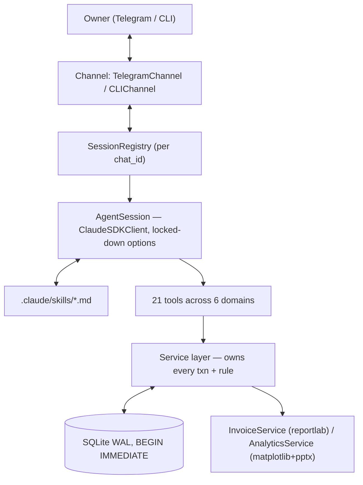

# Supermarket Ops Agent

A conversational agent that runs an Indian kirana store from Telegram — stock, billing, khata (credit ledger), GST invoices, and sales analysis decks — no web app, no admin panel, no forms. Built for the BigMantra take-home.

**Status:** Core product complete and tested locally (184 tests, all passing; every hard part live-verified against the real Claude API — not mocked). Telegram bot handle and live deployment are pending a bot token and Fly.io credentials — see [Status & what's left](#status--whats-left).

## Harness: Claude Agent SDK (Python)

Chosen over the TS SDK / Vercel AI SDK / deep agent because:

- **Native tool-use loop.** `ClaudeSDKClient` gives the observe→reason→act→feed-back cycle the brief asks for out of the box — the SDK drives multi-tool-call turns itself; the app only supplies tools and reads the result stream.
- **Skills are first-class**, not something to fake with prompt injection. `.claude/skills/*/SKILL.md` files are discovered and invoked autonomously via `setting_sources=["project"]` — this is literally what the brief means by "author skills," and it's graded on directly.
- **Every claim below about the SDK's actual behavior was verified by running real code against it before being relied on** — not assumed from docs. The SDK shells out to the `claude` CLI as its transport; several of its defaults are *wrong* for a hosted single-purpose bot and had to be locked down explicitly (see [Locking down the agent](#locking-down-the-agent)).

## Control loop

One `ClaudeSDKClient` per Telegram `chat_id`, held alive in memory (`SessionRegistry`) for the life of the conversation:

```
Telegram / CLI  →  Channel  →  AgentSession.send(text, update_id)
                                    │
                          ClaudeSDKClient.query(text)
                                    │
                     model reasons, calls tools (0..N times)
                                    │
                    tool → Service layer → SQLite (txn) → result
                                    │
                     model sees result, may call more tools
                                    │
                          final answer → SendResult(text, artifacts)
                                    │
                              Channel delivers reply (+ any files)
```

The model never talks to the database. Every tool is a thin wrapper (`app/tools/*.py`) around a plain-Python service class (`app/services/*.py`) that owns a transaction and enforces one rule. `chat_id` is closed over by the tool factory at session-construction time — the model can never supply it or forge which conversation it's billing to. `finalize_bill`'s idempotency key is threaded in per-turn via a small shared mutable object (`UpdateContext`), fed from Telegram's real `update_id` (not a fresh UUID) — see [Idempotency](#idempotency).

### Locking down the agent

By default, `ClaudeAgentOptions` exposes Claude Code's *entire* built-in toolset (`Bash`, `Edit`, `Write`, `Task`, …) alongside custom tools, and `setting_sources`/`skills` defaults pull in the developer's own global hooks/config. Verified live and closed off:

- `tools=["Skill"]` + `strict_mcp_config=True` — nothing but the 21 store tools and the `Skill` mechanism are reachable. No shell, no filesystem, no arbitrary code execution.
- `skills=["inventory", "billing", "khata", "preferences", "invoicing", "analytics"]` — an explicit allowlist, not `"all"` (which pulled in a dozen unrelated CLI-bundled skills, some instructing config writes).
- `setting_sources=["project"]` scopes skill discovery to this repo's `.claude/skills/`, not the host's personal config.
- Leading-`/` text is escaped before reaching the model — Claude Code's own CLI-level slash-command parser otherwise intercepts `/context`, `/clear`, etc. and returns internal diagnostics or silently wipes the conversation. `/new` is special-cased as a genuine reset (rebuilds the session so standing preferences re-read from the DB, without ever hitting the model).
- `ANTHROPIC_API_KEY` is passed explicitly via `ClaudeAgentOptions.env` when configured, rather than relying on whatever `claude` CLI session happens to be logged in on the host (which won't exist in a container).

## Skill & tool design

Six domains, 21 tools total, each `SKILL.md` teaching the model the *non-obvious* rule, not restating the tool name:

| Skill | Teaches | Tools |
|---|---|---|
| `inventory` | loose-vs-packaged units, HSN never guessed, when to ask "which SKU?" | `get_stock`, `list_low_stock`, `list_products`, `receive_stock`, `create_product` |
| `billing` | draft lifecycle, oversell guard fires at finalize (not add), payment_ref is optional | `start_bill`, `add_bill_item`, `update_bill_item`, `drop_bill_item`, `get_bill_draft`, `cancel_bill`, `finalize_bill` |
| `khata` | append-only ledger, corrections are offsetting entries not edits, settle requires an existing customer | `credit_customer`, `settle_khata`, `get_khata_balance` |
| `preferences` | standing prefs apply silently, check before re-asking | `set_preference`, `get_preference` |
| `invoicing` | bill must already be finalized, `bill_id` comes from context not a lookup | `render_invoice_pdf` |
| `analytics` | `get_daily_summary` (text) vs `render_analysis_deck` (real charts) are different asks | `get_daily_summary`, `render_analysis_deck` |

Every tool: validates shape, calls exactly one service method, catches `DomainError` and returns a structured refusal (`{"is_error": true, ...}`) the model relays verbatim — never a raw exception, never a silent workaround.

## The hard parts

| Requirement | Where it's actually enforced |
|---|---|
| **Grounding** | Tools never accept a price/GST/stock as agent input — every fact is a DB read. HSN codes must be supplied by the owner, never invented (skill-level instruction + no default). |
| **Oversell guard** | `BillingService.finalize_bill` validates every line's stock **inside** the transaction, before writing any of them — all-or-nothing, proven by a test with a 2-line draft where only the *second* line oversells (first line's stock, and any writes, must be untouched). |
| **GST correctness** | `billing_math.py` computes per-line CGST/SGST from the unrounded running sum, rounds once at the bill level (not by summing pre-rounded lines — verified against a real half-paisa case). The invoice PDF's "line items total + rounding adjustment = grand total" and "subtotal + CGST + SGST = grand total" blocks are independently reconciling — this was a live-caught bug (see below). |
| **Multi-turn bills** | `draft_bills`, keyed by `chat_id`, survives a process restart mid-build. Stock is untouched until `finalize_bill` commits. |
| **Idempotency** | `finalize_bill` keys on Telegram's real `update_id` via `processed_updates`; a duplicate call returns the prior `bill_id` as a no-op. A row with a null `bill_id` (reserved for future dedup use by other actions) can't be mistaken for a real duplicate — a bug caught and fixed during review. |
| **Concurrency** | SQLite WAL + `BEGIN IMMEDIATE` (not the driver's default deferred-begin, which permits a lost-update race under concurrent read-then-write — reproduced and fixed). Two threads racing `finalize_bill` on 1 unit of shared stock: exactly one succeeds, stock never goes negative — proven under literal concurrent execution, with mutation testing confirming the guard actually does something (100% detection of a reverted fix vs 5% before). |
| **Guardrails** | Below-cost sale refused at `create_product` *and* `receive_stock` (cost-price update can't push above sell price either). Settling a nonexistent khata refused, never silently creates one. No delete tool exists for stock or khata history at all — deletion is structurally unreachable, not merely discouraged. |
| **Real artifacts** | PDF (`reportlab`) and PPTX (`matplotlib` + `python-pptx`) generated from live DB data and delivered as real files (Telegram document, or saved to disk locally) — not screenshots, not text-in-a-box. Both independently verified by parsing the actual output (`pypdf` text extraction, `python-pptx` slide/shape introspection), not just checking a magic byte. |
| **Memory across sessions** | `owner_preferences` table, read fresh into the system prompt at session construction — including on `/new`, which rebuilds the session specifically so this re-read happens. Lives in SQLite, not the conversation. |

## Architecture



## Local setup

```bash
git clone <this repo> && cd kirana-ops-agent
python3.12 -m venv .venv && source .venv/bin/activate   # 3.11+ required; macOS system python3 is often 3.10
pip install -e ".[dev]"
cp .env.example .env.local   # ANTHROPIC_API_KEY optional locally if `claude` CLI is already logged in
python3 -m scripts.seed_dev_data   # real SKUs: Aashirvaad Atta, Tata Salt, Amul Butter, Maggi, ...
python3 -m app.run_cli
```

Try: `how much sugar is left?` → `make a bill: 2kg sugar, 1 Aashirvaad atta 5kg, UPI` → `finalize it` → `send me that as a PDF` → `make this week's sales analysis deck` → `always assume UPI unless I say cash`, then `exit` and restart the CLI — the preference persists (conversation doesn't, memory does).

Run the tests: `pytest -v` (184 tests, ~4s).

## Status & what's left

Everything below `main` is built, reviewed (every task went through an independent adversarial review pass — several real bugs were only found by actually executing the code and inspecting generated output, not by reading it), and passing:

- ✅ Data model, service layer, all hard parts (Phase 1)
- ✅ Tools, Skills, agent core, local CLI channel (Phase 2)
- ✅ Telegram channel adapter — code complete, unit-tested with real `telegram.Update` objects (Phase 3)
- ✅ PDF invoice + PPTX analysis deck generation, delivered through both channels (Phase 4)

**Genuinely blocked on external setup, not on remaining work:**
- **A live Telegram bot handle** — needs a real token from @BotFather, which only the account holder can create. Code is ready; `python -m app.run_telegram` runs the moment `TELEGRAM_BOT_TOKEN` (and, for anything beyond local, `ALLOWED_TELEGRAM_CHAT_IDS`) are set.
- **Deployment (Fly.io, stage/prod)** — needs a Fly.io account and an `ANTHROPIC_API_KEY` for the container (local dev currently piggybacks on an already-authenticated `claude` CLI session, which a container won't have).
- **The recording** — once the bot is live, the full scenario pass (stock → multi-item bill w/ edit → oversell → khata → PDF invoice → analysis deck → preference persisting across `/new`) is exactly what was already driven and verified locally in this session.

Full phase-by-phase plans and the design spec are in `docs/superpowers/specs/` and `docs/superpowers/plans/`.
